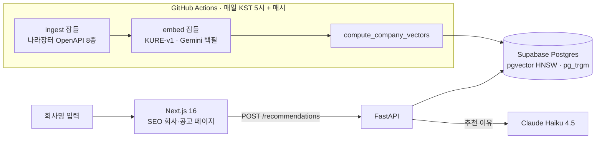

# jodalfit (조달핏)

회사명을 입력하면 등록업종·공급물품·수주 이력을 함께 분석해, 검토할 만한 나라장터(G2B) 입찰공고 20건을 추천한다 (비로그인은 상위 5건 공개).


[](https://jodalfit.co.kr)


## 한눈에

**문제.** 입찰 알리미는 키워드 알림이라 "우리가 들어갈 수 있는 공고"와 "검토할 가치가 있는 공고"를 구분하지 못한다.

**접근.** 회사를 벡터로 만들어 공고와 비교한다. 다만 임베딩은 후보 정렬용이고, 자격(면허·지역·마감) 하드 필터가 먼저다. 100점 매칭이어도 자격이 안 되면 못 들어가기 때문이다.

**실데이터로 확인한 것.** 초기 설계는 "과거 수주 이력"을 메인 시그널(α=0.7)로 잡았다. 실데이터에 돌려 보니 수주 이력이 매칭되는 회사가 1.1%에 그쳐 추천이 성립하지 않았다.
"이 회사가 뭐 하는 회사인가"(등록업종·공급물품)를 메인으로 옮기고, 가중치를 회사 데이터 양에 따라 동적으로 정하는 쪽으로 피벗했다 (2026-05-25).

**규모 (2026-11-05).** 공고 누적 41.8만 건(지금 입찰 가능 약 9,500건), 계약 67.6만 건, 회사 19.6만 개(벡터 91,585). 나라장터 OpenAPI 8종을 GitHub Actions(매일 05:00 + 매시)로 누적한다.

**상태.** [jodalfit.co.kr](https://jodalfit.co.kr) 운영 중. 이메일·구글·네이버 로그인, 검토함, 저장 회사 주간 메일, 어드민. 임베딩은 KURE-v1 운영 중이고 Gemini embedding-001 로 전환하기 위한 백필이 진행 중이다(아래 6장).

---

## 1. 무엇을 만드는가

한국 공공조달(나라장터, G2B) 입찰공고 추천 사이트.

**컨셉:**
1. 사용자가 **회사명** 또는 **사업자번호**를 입력
2. **등록업종 · 공급물품 (메인)** + **과거 수주 이력 (보조)**을 합쳐 회사 임베딩 벡터 생성
3. 신규 입찰공고와 의미적으로 비교 → **20건** 반환 (비로그인은 상위 5건 공개 + 15건 흐림)
4. **LLM**이 "왜 이 공고가 맞는지" 자연어로 설명 (병렬 호출로 ~3초)

회사명/벡터 미확보 시에는 **자유 키워드 모드**로 폴백 — 콜드스타트에도 즉시 추천.

**경쟁사 대비 차별화:**

| 일반 입찰 알리미 | jodalfit |
| --- | --- |
| 키워드 알림 | **등록업종/공급물품 + 수주 이력 통합 임베딩 매칭** |
| 점수 없음 | 매칭 점수 + 게이지 + 적합도 라벨 |
| 이유 없음 | **LLM이 "왜 추천했는지" 자연어 설명** ⭐ |
| 단일 공고 페이지만 | **발주계획 → 사전규격 → 공고 → 낙찰 → 계약 라이프사이클 페이지** ⭐ |
| 자격 미확인 공고 다수 | **자격(면허/지역/마감) 하드 필터** |

---

## 2. 핵심 알고리즘 (2026-05-25 PIVOT — 업종 메인 + 동적 가중치)

> 초기 설계는 수주 메인(α=0.7)이었으나, 실데이터 검증 결과 수주 매칭 커버리지가 1.1%에 그쳐 추천 자체가 불가능했습니다.
> "이 회사가 **뭐 하는 회사인가**"가 메인 시그널이고, **과거에 뭘 따냈는가**는 보조라는 사용자 직관 + 코덱스 재검토를 반영해 **γ(업종)을 메인**으로 옮기고 가중치를 동적으로 산출합니다.

**회사 벡터 = 3가지 시그널의 동적 가중합**

```
회사 벡터 = α · 수주벡터 + β · 관심벡터 + γ · 업종벡터   (α+β+γ = 1, 회사 데이터별 동적)
```

| 회사 상태 | 업종 γ | 수주 α | 관심 β | 메모 |
| --- | --- | --- | --- | --- |
| 수주 **0건** (콜드스타트) | **1.00** | 0.00 | 0.00 | 등록업종만으로 추천 |
| 수주 1~5건 (균형) | **0.65** | 0.30 | 0.05 | 업종 메인, 수주 보조 |
| 수주 **6건+** (수주 풍부) | **0.50** | 0.45 | 0.05 | 업종/수주 비등 |

**시그널 소스**

| 시그널 | 소스 |
| --- | --- |
| **업종(γ)** | `company_industries` 등록업종 + `company_supply_products` 공급물품 + `corp_bsns_div_nm` + `mnfctr_div_nm` 텍스트 (회사당 1회 임베딩) |
| **수주(α)** | `contracts` → 따낸 공고들의 `bid_notices.embedding` 평균 |
| **관심(β)** | 사전규격 의견 (v0.2.1 — 회사명 매핑 후 활성화) |

가용한 시그널만 정규화해서 가중합 → 콜드스타트도 즉시 추천 가능.
회사 식별/벡터가 없으면 **키워드 모드**(자유 텍스트 → 직접 임베딩)로 폴백.

**추천 파이프라인:**

```
회사명 입력
    ↓
[1] 회사 식별 (pg_trgm fuzzy + 사업자번호 매칭)
    ↓
[2] 하드 필터  ← 못 들어가는 공고 제거 (자격/지역/마감/예산)
    ↓
[3] pgvector 코사인 검색  ← 통과 공고 중 TOP 100
    ↓
[4] 휴리스틱 rerank  ← 마감 임박 패널티, 지역 매칭 보너스 등
    ↓
[5] LLM 설명 생성  ← Claude Haiku 4.5, ThreadPoolExecutor(5) 병렬 호출 (~3초)
    ↓
20건 + 매칭 이유 반환
```

**핵심 통찰**:
1. **회사 정체성(업종/공급물품)이 메인 시그널** — "내 회사는 SI"라는 정신 모델이 "과거에 한 번 청소용역 했음"보다 강함.
2. **"의미 유사도"보다 "실제 입찰 가능성"이 더 큰 결정 요인** — 자격이 안 맞으면 매칭 100점이어도 못 들어감. 그래서 하드 필터가 메인, 임베딩은 후보 정렬용 보조.
3. 우리 서비스 성격은 "낙찰 예측"이 아니라 **"검토할 만한 공고 디스커버리"** — 카피와 점수 표현 모두 이 방향.

---

## 3. 데이터 라이프사이클

조달 단계마다 별도 OpenAPI가 있고, jodalfit은 **모든 단계를 누적**합니다.

```
[발주계획] → [사전규격(+의견)] → [입찰공고] → [낙찰/개찰] → [계약]
       선행지표        SW식별, 관심신호       추천 대상     참여신호    수주신호
```

| 단계 | API 서비스 | 핵심 가치 |
| --- | --- | --- |
| 발주계획 | `OrderPlanSttusService` | "1개월 전" 알림 가능 |
| 사전규격 | `HrcspSsstndrdInfoService` | `swBizObjYn` SW 사업 자동 필터 |
| 사전규격 의견 | 동일 (`getPublicPrcureThngOpinionInfo*`) | **회사 관심 신호** (콜드스타트 해결) |
| 입찰공고 | `PubDataOpnStdService/getDataSetOpnStdBidPblancInfo` | 추천 대상 공고 풀 |
| 입찰공고 자격 | `BidPublicInfoService` (면허제한/참가지역) | **자격 하드 필터** |
| 낙찰/개찰 | `ScsbidInfoService` | **참가 업체 정보** = 회사 3번째 시그널 |
| 계약 | `PubDataOpnStdService/getDataSetOpnStdCntrctInfo` | **사업자번호 → 수주 이력** |
| 회사 마스터 | `UsrInfoService02` | 등록업종, 공급물품, 부정당 제재 |
| 업종 lookup | `IndstrytyBaseLawrgltInfoService` | 자격요건 매핑 |

---

## 4. 아키텍처



추천 요청 경로: 회사 식별(pg_trgm) → 자격 하드 필터 → pgvector 코사인 TOP 100 → 가중치 score + 협업 시그널 + MMR 다양성 → LLM 설명(병렬).

---

## 5. 폴더 구조

<details>
<summary>펼치기 (2026-11-05 기준)</summary>

```
jodalfit/
├── backend/                       FastAPI + 데이터 수집/임베딩/평가 잡 (Python 3.12, uv) — Railway
│   ├── app/
│   │   ├── main.py                FastAPI 진입점 (Sentry: 바깥 요청에 trace 헤더 안 붙임)
│   │   ├── api/                   recommendations(추천·스트림) / qualifications(자격 라벨) / events(행동 로그·도움됨) / feedback
│   │   ├── core/                  config(환경변수 스위치 전부) / rate_limit / bot_guard / traffic_source(internal·bot·user) / timing / progress
│   │   ├── services/              recommend(회사 식별·후보 검색·v1) / recommendation_cache / explain(LLM 설명)
│   │   │                          embedding(공간 스위치 openai·kure·gemini + 캐시) / local_embed(KURE ONNX) / gemini_client
│   │   │                          doc_extract(hwp·hwpx·pdf·xlsx 본문) / notice_insights(LLM 구조화) / viz / search_log / notice_events
│   │   └── recommender/           v2 랭커 — pipeline / cancellation(취소공고 제외) / qualifications(자격 하드 필터) / score / collaborative / mmr
│   │                              + evaluation(지표) / keyword_expand(영문 약어 풀이) / title_match(키워드 모드 글자 일치)
│   ├── jobs/                      CLI 잡. 접두사 규칙 — ingest_*(나라장터 API 수집 14종) / embed_*(공고·사전규격·발주계획) /
│   │   │                          compute_company_vectors / extract·summarize·purge_*(첨부문서 파이프라인) / check_*·verify_*·diag_*(건강 점검)
│   │   │                          evaluate_recommender(채점표)·fit_score_weights·sweep_score_scale / send_weekly_mail / register_searched_companies
│   │   └── marketing_report/      일일 마케팅 성적표 (서치콘솔·GA4·네이버 서치어드바이저)
│   ├── pyproject.toml             extras: embed-cpu / embed-gpu (상호 배제)
│   └── .env.example
│
├── frontend/                      Next.js 16 (App Router, React 19, TS, Tailwind v4) — Vercel
│   ├── src/
│   │   ├── app/
│   │   │   ├── (renewal)/         모든 페이지 (라우트 그룹 — URL 은 그대로). layout.tsx 가 nav·footer, 쿠키를 읽어 전부 동적 렌더
│   │   │   │   ├── page.tsx                      입구 — 회사·키워드 검색 + 오늘의 공고
│   │   │   │   ├── recommendations/              추천 결과 (비로그인 5건 + 15건 흐림) · report/ (A4 인쇄)
│   │   │   │   ├── companies/[bizrno]/           ★ 회사 SEO 페이지 (수주 이력 → 검토할 공고) · browse/[sido] · industry/[code]
│   │   │   │   ├── notices/[bid_ntce_no]/        ★★ 공고 상세 (근거·자격·라이프사이클·첨부 인사이트)
│   │   │   │   ├── saved/ · welcome/             검토함(저장 회사·공고, 주간 메일 토글) · 가입 직후 우리 회사 저장
│   │   │   │   ├── login/ signup/ reset/ consent/  이메일+비밀번호 · 구글 · 네이버(custom OAuth) 로그인
│   │   │   │   ├── changelog/ about/ faq/ feedback/  개선 기록(lib/changelog.ts 의 PUBLIC_CHANGES 만) · 소개 · FAQ · 의견
│   │   │   │   ├── admin/                        읽기 전용 운영 숫자 (ADMIN_EMAILS 만, 아니면 404)
│   │   │   │   ├── mail/weekly/                  주간 메일 그만 받기 확인
│   │   │   │   └── terms/ privacy/ dev/foundation/
│   │   │   ├── api/               route handler — companies/suggest(자동완성, 사업자번호 비노출) · companies/[bizrno]/{profile,recommendations}
│   │   │   │                      notices/[no]/similar · saved/companies · consent · interest(미출시 기능 수요 조사) · mail/weekly · auth/naver/userinfo
│   │   │   ├── auth/              confirm(메일 링크 → 세션) · callback(OAuth code 교환)
│   │   │   ├── sitemap.ts · sitemap-index.xml/ · robots.ts · opengraph-image.tsx (루트·회사·공고)
│   │   │   └── layout.tsx         Pretendard, 메타데이터
│   │   ├── components/            entry/ · results/ · company/ · notice/ · admin/ · ui/(shadcn base-nova) + Brand·Nav·Gate·JsonLd 등 낱개
│   │   ├── lib/                   server-only 읽기(supabase-server·company·notice·saved·entry·changelog·admin) /
│   │   │   │                      auth(getSessionUser)·after-auth·safe-next / supabase/{browser,server}(쿠키 세션) /
│   │   │   │                      analytics(PostHog)·events / mail-link(HMAC) / jsonld / why·format(+ *.test.ts)
│   │   ├── proxy.ts               Next 16 의 middleware — 세션 갱신만
│   │   └── instrumentation*.ts · sentry.server.config.ts
│   ├── scripts/                   check_*.py — Playwright 화면 검증 9종(금지어·주황 면·390 가로 넘침) · auth_smoke.mjs · shoot_design.py
│   ├── public/                    brand/ · llms.txt(GEO) · 검색엔진 소유 확인 파일
│   └── vercel.json
│
├── supabase/migrations/           0001~0068 — Dashboard SQL Editor 에서 번호 순 수동 적용
│                                  (0045 kure 공간 · 0046 임베딩 캐시 · 0062 anon 기본 권한 회수 · 0067 gemini 공간 · 0068 feature_interest)
│
├── .github/workflows/             daily-sync(매일 05:00 수집→임베딩→건강 점검) · hourly-sync(매시 공고·상세·임베딩 500건)
│                                  documents-sync(2시간, 첨부 추출·요약) · weekly-mail(월 08:00)
│
├── docs/
│   ├── recommender/               evaluation.md(채점 규칙) · baseline-*.md · exp-*.md(실험) · changelog.md(사용자 언어 변경 기록)
│   ├── design/                    리뉴얼 결정(README.md) · brand/(로고) · prototypes/final/(최종 시안) · scripts/
│   ├── security/ · infra/ · marketing/ · superpowers/plans/(실행한 구현 계획)
│   └── roadmap-2026-10.md
│
├── data/                          임시 수집 데이터 (gitignored)
├── PRODUCT.md                     사용자·성공 기준·카피 원칙
├── CLAUDE.md                      프로젝트 가이드
├── DESIGN.md                      폐기된 옛 디자인 기록 (현행 아님 — docs/design/README.md 가 현행)
└── README.md                      (이 파일)
```

</details>

---

## 6. 스택

| 영역 | 선택 | 이유 |
| --- | --- | --- |
| **백엔드** | FastAPI (Python 3.12, uv) | 비동기 잘 됨, 한국 데이터 다루기 편함 |
| **DB / Auth** | Supabase (Postgres + pgvector + pg_trgm) | pgvector HNSW로 임베딩 검색, fuzzy 회사명 매칭, Auth 내장 |
| **임베딩 (운영)** | KURE-v1 (1024d, `embedding_k`) — Railway 에 int8 ONNX 상주 | 한국어 전용 모델. 2026-10-15 OpenAI 3-small 에서 전환 |
| **임베딩 (전환 중)** | Gemini `gemini-embedding-001` (768d, `embedding_g`) | 2026-11-04 재대결(회사 3,000곳 × 3시점)에서 KURE 대비 final@20 +0.06, 전 시점·전 군 상승 (`docs/recommender/exp-2026-11-04-embedding-rematch.md`). 백필 완료 후 `EMBED_SPACE=gemini` 로 전환 |
| **임베딩 공간 스위치** | `EMBED_SPACE` = `openai` / `kure` / `gemini` | 공간마다 열·RPC 접미사·함수가 한 벌(`app/services/embedding.py`). 환경변수 하나로 전환·롤백 |
| **LLM 설명** | Claude Haiku 4.5 (`EXPLAIN_PROVIDER=anthropic`, 키 없으면 `gpt-4o-mini` 로 degrade) | 추천 이유 생성용 |
| **프론트엔드** | Next.js 16 (App Router, TS, Tailwind v4) | SSR/SSG, SEO 강점, React 19 |
| **UI** | shadcn 패턴 + Radix UI primitive + Pretendard | 한국 B2B 신뢰감 + 접근성 |

---

## 7. 셋업

<details>
<summary>펼치기</summary>

### 사전 준비

1. **Python 3.12** + [uv](https://docs.astral.sh/uv/) 설치
2. **Node.js 20+** + npm
3. **Supabase 프로젝트** (Seoul region 권장)
4. **공공데이터포털 API 키** — [data.go.kr](https://data.go.kr)에서 아래 8개 서비스 활용신청
   - 조달청_나라장터 공공데이터개방표준서비스
   - 조달청_나라장터 사전규격정보서비스
   - 조달청_나라장터 발주계획현황서비스
   - 조달청_나라장터 사용자정보 서비스 (UsrInfoService02)
   - 조달청_나라장터 업종 및 근거법규서비스
   - 조달청_나라장터 계약과정통합공개서비스
   - 조달청_나라장터 입찰공고정보서비스
   - 조달청_나라장터 낙찰정보서비스
5. **OpenAI API 키** — [platform.openai.com](https://platform.openai.com)

### Supabase 스키마 적용

`supabase/migrations/*.sql`을 **번호 순서대로** Dashboard → SQL Editor에서 실행:

```
0001_init.sql                      # 기본 12개 테이블 + pgvector + pg_trgm
0002_bizrno_normalize.sql          # 사업자번호 정규화 컬럼
0003_match_rpc.sql                 # 추천 검색용 RPC
0004_embedding_update_rpc.sql      # 임베딩 batch UPDATE RPC
0005_license_rgn_tables.sql        # 면허제한 + 참가지역 테이블
```

### 백엔드 셋업

```bash
cd backend
cp .env.example .env
# .env 파일에 다음 4개 키 채우기:
# NARAJANGTEO_API_KEY=...        ← 공공데이터포털 일반인증키 (Decoded)
# OPENAI_API_KEY=sk-...          ← OpenAI API key
# SUPABASE_URL=https://...       ← Supabase Dashboard → Settings → API
# SUPABASE_SERVICE_ROLE_KEY=...  ← service_role (anon 아님, 매우 민감)

uv sync
uv run python -m jobs.verify_phase2  # 연결 점검
uv run uvicorn app.main:app --reload  # → http://localhost:8000
```

### 프론트엔드 셋업

```bash
cd frontend
cp .env.local.example .env.local
# .env.local:
# NEXT_PUBLIC_API_BASE_URL=http://localhost:8000
# NEXT_PUBLIC_USE_MOCK=false  (또는 true로 두면 백엔드 없이 디자인 확인 가능)
# NEXT_PUBLIC_SUPABASE_URL=...
# NEXT_PUBLIC_SUPABASE_ANON_KEY=...   ← anon 키, frontend에서만 사용

npm install
npm run dev  # → http://localhost:3000
```

---

</details>

---

## 8. 데이터 파이프라인

<details>
<summary>펼치기</summary> (잡 실행 순서)

처음 시드 적재 시 권장 순서:

```bash
cd backend

# === 1. 데이터 수집 ===
# 입찰공고 1주일치 (최대 한도)
uv run python -m jobs.ingest_bid_notices --days-back 7 --batch-size 100

# 입찰공고 첨부파일 목록 (제안요청서 등 링크) — bid_notices 적재 후 실행, 최대 30일
uv run python -m jobs.ingest_bid_attachments --days-back 7

# 첨부파일 본문 텍스트 추출 (hwp/hwpx/pdf/xlsx + zip 전개 → bid_notice_documents) — 진행 중 공고, 최신순
uv run python -m jobs.extract_bid_documents --limit 200

# 마감+7일 지난 공고의 문서 텍스트 비우기 (status='purged') — 저장 증가 차단, daily-sync 에 포함
uv run python -m jobs.purge_expired_documents

# 문서 텍스트 → LLM 구조화 인사이트 (과업요약·자격요건·평가 → bid_notice_insights). 추천 설명·상세 UI용, 임베딩엔 미사용
# OpenAI Batch API(정가 50%): 한 번 실행 = 이전 배치 결과 수거 + 최대 --limit건 제출(500 단위 배치 여러 개). 수의계약 제외(0029)
uv run python -m jobs.summarize_bid_documents --limit 100

# 계약 1주일치 (회사 수주 신호의 원천)
uv run python -m jobs.ingest_contracts --days-back 7 --batch-size 100

# 사전규격 (SW 사업만)
uv run python -m jobs.ingest_pre_specs --days-back 7

# 사전규격 의견 (회사 관심 신호)
uv run python -m jobs.ingest_pre_spec_opinions --days-back 7

# 발주계획 (선행지표, 분기별이라 sparse)
uv run python -m jobs.ingest_order_plans --months-back 6

# 회사 마스터 풍부화 (UsrInfoService02 — 변경일 기반, 시드는 길게)
uv run python -m jobs.ingest_companies_userinfo --days-back 90

# 부정당 제재 (자격 박탈된 회사 자동 필터)
uv run python -m jobs.ingest_restricted_corps --days-back 90

# 면허제한 / 참가지역 (자격 하드 필터의 핵심)
uv run python -m jobs.ingest_license_limit --days-back 7
uv run python -m jobs.ingest_rgn_limit --days-back 7

# 낙찰자 목록 (참여 신호)
uv run python -m jobs.ingest_scsbid_winners --days-back 7

# 참가업체 rank 2+ (회사 참가 시그널 — 낙찰자 수집 후 실행)
uv run python -m jobs.ingest_bid_participants --days-back 7 --limit 2000


# === 2. 임베딩 생성 ===
uv run python -m jobs.embed_bid_notices --limit 100000 --batch 50
uv run python -m jobs.embed_pre_specs --limit 10000 --batch 50
uv run python -m jobs.embed_order_plans --limit 5000 --batch 50


# === 3. 회사 벡터 통합 ===
uv run python -m jobs.compute_company_vectors --limit 25000 --chunk-size 100


# === 검증 ===
uv run python -m jobs.verify_setup
```

매일 자동 갱신은 `--days-back 1`로 cron 등록.

---

</details>

---

## 9. 환경변수

<details>
<summary>펼치기</summary>

`backend/.env`:

| 키 | 설명 | 예시 |
| --- | --- | --- |
| `NARAJANGTEO_API_KEY` | 공공데이터포털 일반인증키 (Decoded 형식) | `3393eec4c0...` |
| `OPENAI_API_KEY` | OpenAI API 키 | `sk-proj-...` |
| `SUPABASE_URL` | Supabase 프로젝트 URL | `https://xxx.supabase.co` |
| `SUPABASE_SERVICE_ROLE_KEY` | service_role 키 (admin 권한, 매우 민감) | `eyJhbG...` |
| `CORS_ORIGINS` | (선택) JSON 배열 | `["http://localhost:3000"]` |
| `RECO_RETRIEVAL` | 후보 검색 방식 dense/hybrid — 문제 시 dense 로 즉시 롤백 (0044 필요) | `hybrid` |
| `ANTHROPIC_API_KEY` | 첨부문서 인사이트(Haiku) | (비움) |
| `INSIGHT_PROVIDER` | 인사이트 공급자, openai 로 롤백 | `anthropic` |
| `EXPLAIN_PROVIDER` | 추천 설명 공급자 (anthropic=Haiku 4.5 기본 / openai=gpt-4o-mini). anthropic 인데 키 없으면 openai 로 degrade | `anthropic` |
| `DATABASE_URL` | Postgres 직결(세션 풀러 :5432) — backfill/사업자상태/purge/채점표 잡 | `postgresql://...` |
| `EMBED_SPACE` | 임베딩 공간 `openai`(1536d, `embedding`) / `kure`(1024d, `embedding_k`+`_k` RPC, 0045) / `gemini`(768d, `embedding_g`+`_g` RPC, 0067). 롤백 = 이 값 하나 | `openai` |
| `GEMINI_API_KEY` | Google AI Studio 키 — `EMBED_SPACE=gemini` 일 때만(질의/문서 taskType 분리, `app/services/gemini_client.py`). 결제 연결 필수(무료 등급은 분당 한도) | `AIza...` |
| `KURE_MODEL_DIR` | KURE ONNX 모델 캐시 경로. 비우면 임시 폴더 → Railway 재시작마다 409MB 재다운로드. 영구 볼륨을 가리킬 것 | `/data/kure` |
| `INDEXNOW_KEY` | (선택) IndexNow 키 — `jobs.ping_indexnow`(매시, Bing·네이버). 비우면 코드의 기본 키. 바꾸면 `frontend/public/<key>.txt` 도 같이 | (비움) |
| `RESEND_API_KEY` | (선택) `/feedback` 접수 때 운영자 알림 메일과 주간 메일(`jobs.send_weekly_mail`, GitHub Actions `weekly-mail.yml` — 리포 Secrets 에도 넣는다). 발신 `noreply@jodalfit.co.kr`. 비우면 DB 저장만·주간 메일은 dry-run. Supabase SMTP 와 별도 키를 발급해 둔다(하나를 갈아도 다른 쪽이 안 죽게) | `re_...` |
| `INTERNAL_API_TOKEN` | 내부 호출 식별(bot_guard·traffic_source) + 주간 메일 "그만 받기" 링크의 HMAC 비밀. Railway·Vercel·GitHub Secrets 세 곳이 같은 값이어야 한다 | (무작위 문자열) |
| `FEEDBACK_NOTIFY_TO` | 알림 받을 주소 | `jansseung@gmail.com` |

`frontend/.env.local`:

| 키 | 설명 |
| --- | --- |
| `NEXT_PUBLIC_API_BASE_URL` | 백엔드 URL (`http://localhost:8000`) |
| `NEXT_PUBLIC_USE_MOCK` | `true` 시 백엔드 없이 mock 데이터로 디자인 미리보기 |
| `NEXT_PUBLIC_SUPABASE_URL` | Supabase URL |
| `NEXT_PUBLIC_SUPABASE_ANON_KEY` | anon 키 (frontend 전용) |
| `NEXT_PUBLIC_EMBED_SPACE` | `openai`(기본) / `kure` / `gemini` — 직접 RPC 호출·벡터 컬럼 분기. 백엔드 `EMBED_SPACE` 와 같이 바꾼다 |
| `ADMIN_EMAILS` | `/admin`(읽기 전용 운영 숫자)을 볼 수 있는 로그인 이메일, 쉼표 구분. 비우면 아무도 못 본다(404) |
| `POSTHOG_PERSONAL_API_KEY` · `POSTHOG_PROJECT_ID` | `/admin` 방문 판(페이지뷰·방문자·유입)이 PostHog 쿼리 API 를 읽는 개인 키(`phx_…`, Settings → Personal API keys, 읽기 권한)와 프로젝트 번호. 없으면 그 판만 "미설정" |

> ⚠️ **보안 주의**:
> - `SUPABASE_SERVICE_ROLE_KEY`는 **RLS를 우회하는 admin 권한**. 절대 frontend나 git에 노출 금지.
> - `OPENAI_API_KEY` 노출 시 누군가 비용을 발생시킬 수 있음.
> - 모든 키는 `.env`에 직접 입력. 채팅/메신저로 공유 금지.

---

</details>

---

## 10. API 사용 예시

```bash
curl -X POST http://localhost:8000/recommendations \
  -H "Content-Type: application/json" \
  -d '{
    "query": "주식회사 제이오달소프트",
    "limit": 5,
    "with_explanation": true
  }'
```

응답 형식:

```jsonc
{
  "company": {
    "bizrno": "1378802300",
    "corp_nm": "주식회사 제이오달소프트",
    "rgn_nm": "서울특별시 강남구",
    "corp_bsns_div_nm": "소프트웨어개발"
  },
  "results": [
    {
      "bid_ntce_no": "R26BK01533268",
      "bid_ntce_nm": "한국교육학술정보원 ... 유지관리 용역",
      "bsns_div_nm": "용역",
      "bid_clse_date": "2026-06-01",
      "presmpt_prce": 178000000,
      "dmnd_instt_nm": "한국교육학술정보원",
      "base_similarity": 0.871,
      "bonus": 0.05,
      "score": 0.921,
      "explanation": "최근 3년간 교육기관 대상 시스템 유지보수 수주 이력이 많고..."
    }
    // ...
  ]
}
```

---

## 11. MVP 단계별 발전 계획

| 버전 | 상태 | 핵심 변화 |
| --- | --- | --- |
| v0.1 | ✅ 완료 | 수주 시그널 + 코사인 + 하드 필터 + LLM 설명 (α=0.7 수주 메인) |
| v0.2 | ✅ 완료 | **PIVOT** — 업종/공급물품 메인(γ), 동적 가중치, 회사 풍부화, 라이프사이클 페이지, GitHub Actions cron, LLM 병렬 |
| v0.3 | ⏳ | 자격 하드 필터 강화 (면허제한 정밀 매칭), 관심 시그널(사전규격 의견) 활성화 |
| v0.4 | ⏳ | 참가업체 시그널(개찰결과) 적재, 시간가중 exp decay (반감기 1년) |
| v0.5 | ⏳ | LightGBM learning-to-rank (수주/참여/노출 데이터 누적 후) |

### 현재 데이터 상태 (2026-11-05)
- `bid_notices` 약 41.8만 건 — KURE 벡터 41.8만, Gemini 벡터 32.7만 (백필 중)
- `contracts` 약 67.6만 건
- `companies` 약 19.6만 개 — 회사 벡터(KURE) 91,585
- `company_industries` 25.6만 행 / `company_supply_products` 101.7만 행
- 추천 알고리즘 변경 이력(사용자 언어)은 `docs/recommender/changelog.md`, 실험 기록은 `docs/recommender/exp-*.md`

자세한 결정 근거는 [`docs/`](./docs/) 또는 깃 커밋 히스토리.

---

## 12. 사용 카피 원칙 (어기지 말기)

- ❌ "낙찰 가능성 92%" → ✅ **"매칭 점수 92 / 매우 적합"**
- ❌ "따낼 만한 공고" → ✅ **"검토할 만한 공고"** (낙찰 예측이 아니라 디스커버리)
- ❌ "과거 낙찰 이력만 분석" → ✅ **"등록업종 · 공급물품 · 수주 이력을 함께 분석"**
- ❌ 사업자번호 전체 노출 → ✅ **"137-XX-X4567" 형식 마스킹**
- ❌ "AI가 다 해준다" → ✅ **"왜 추천했는지" 자연어 설명**
- ❌ 데이터 출처/갱신일 누락 → ✅ **"매일 갱신 · 나라장터 기반" 항상 명시**
- ❌ 다크모드, 회원가입 강제, 카카오 로그인 → ✅ **무료로 먼저 확인 (회원가입 X)**

---

## 13. 디자인 토큰 (2026-10-24 리뉴얼)

종이색 바닥 + 흰 판 + 헤어라인, 먹 글자, **주황 하나**. 결정 사항·시안은 `docs/design/README.md`, 로고는 `docs/design/brand/`.
로고 컨셉: **ㄱㄴ 틀 "찰칵"** — 갈고리 둘(ㄱ 오른 위·ㄴ 왼 아래)이 비껴 마주 보며 네모를 틀 짓는다. 골라서 담는 사진 틀.

```css
/* jodalfit — 종이 · 먹 · 주황 (frontend/src/app/globals.css) */
--color-paper:      #faf9f7;  /* 바닥 */
--color-panel:      #ffffff;  /* 판 */
--color-hair:       #e6e4df;  /* 판 테두리·헤어라인 */
--color-ink:        #141414;  /* 먹 */
--color-ink-dim:    #6b6b67;  /* 흐림 (대비 4.9:1) */
--color-orange:     #f97316;  /* 선·밑줄·점·테두리·D-day. 면 금지 (로고 타일 예외) */
--color-orange-ink: #b85510;  /* 글자용 주황 — #f97316 은 종이색 위 대비 2.66:1 */

--font-sans: 'Pretendard Variable', system-ui, ...;
```

- **주황은 선이지 면이 아니다** — 테두리·밑줄·점에만. 주황 면 위 흰 글씨 금지.
- 문체는 공문 톤(명사형 종결·격식체). "~있어요"류 구어는 `frontend/scripts/check_*.py` 의 금지어 검사가 잡는다.
- 적합 점수 숫자는 노출하지 않고 근거(신호 칩·근거 문장)만 남긴다.
- 다크 모드 없음.

UI 라이브러리: **shadcn/ui base-nova preset** (@base-ui/react 기반). `Button`은 base-ui라 `asChild` 미지원 — 링크는 `<a>` 직접 스타일.

---

## 14. 참고 자료

- [공공데이터포털](https://www.data.go.kr) — 나라장터 OpenAPI
- [국가종합전자조달 나라장터](https://www.g2b.go.kr) — 공식 사이트
- [pgvector](https://github.com/pgvector/pgvector) — Postgres vector extension
- [Pretendard](https://github.com/orioncactus/pretendard) — 한글 폰트
- [Supabase](https://supabase.com/docs) — DB / Auth 플랫폼

---

## 15. 라이선스

© 2026 jodalfit. 라이선스 미정.
